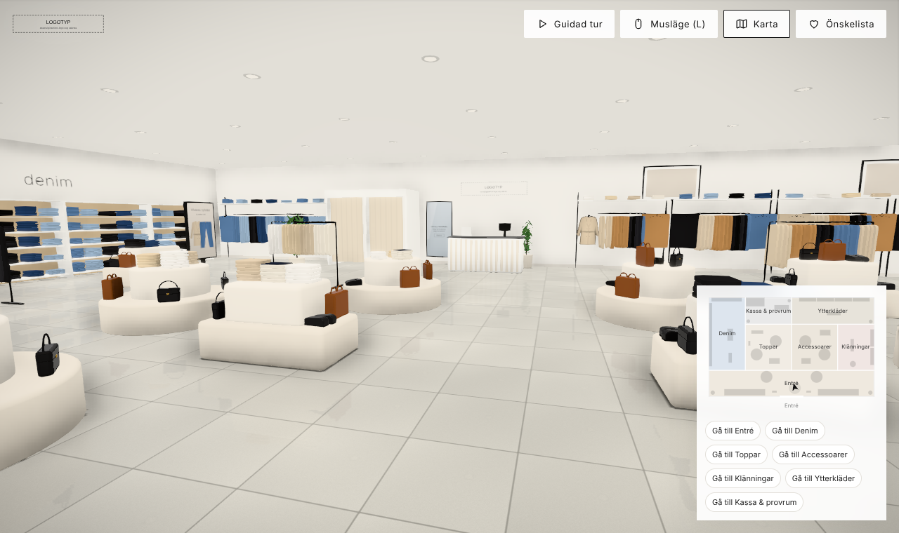
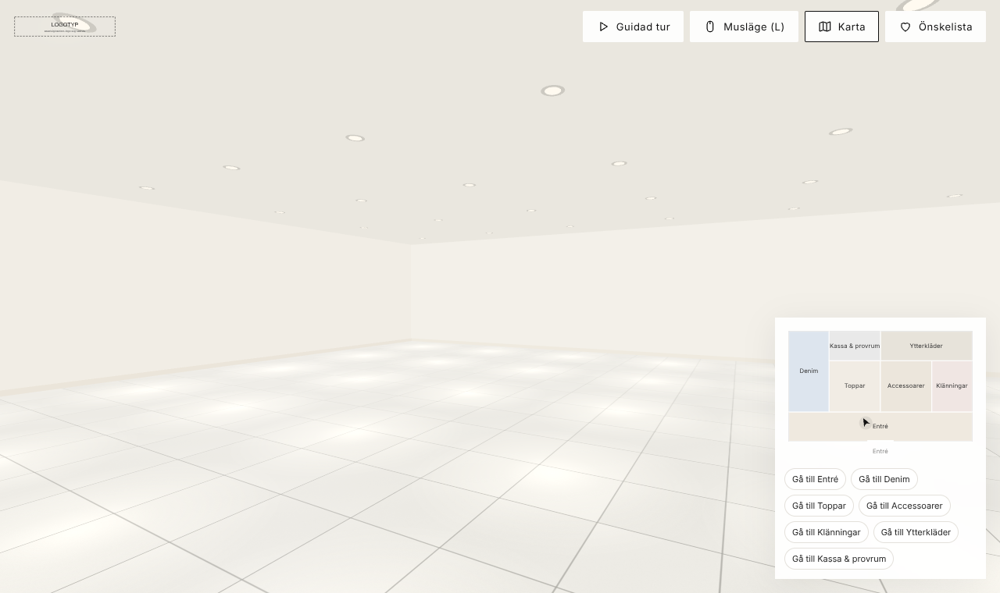
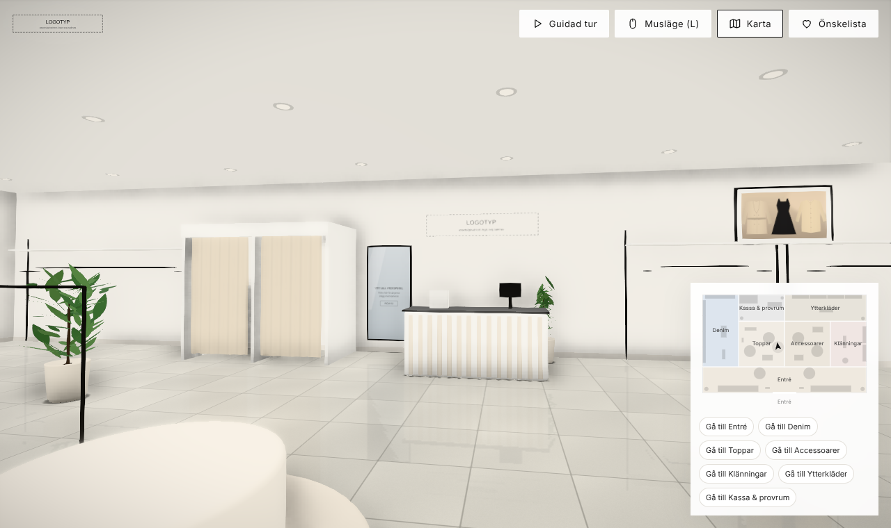
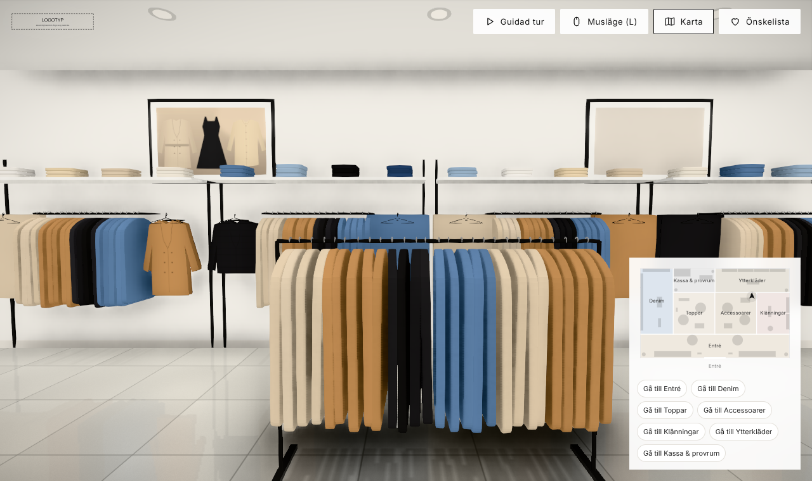
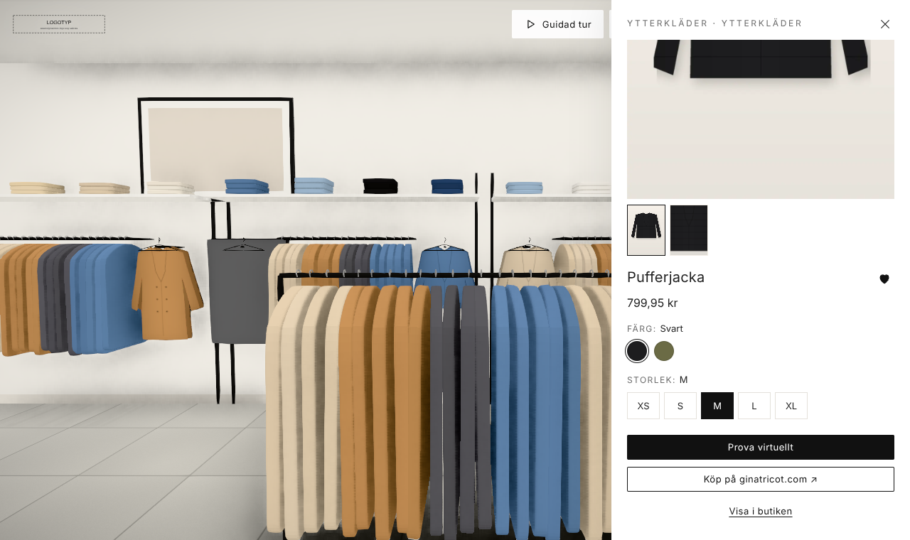
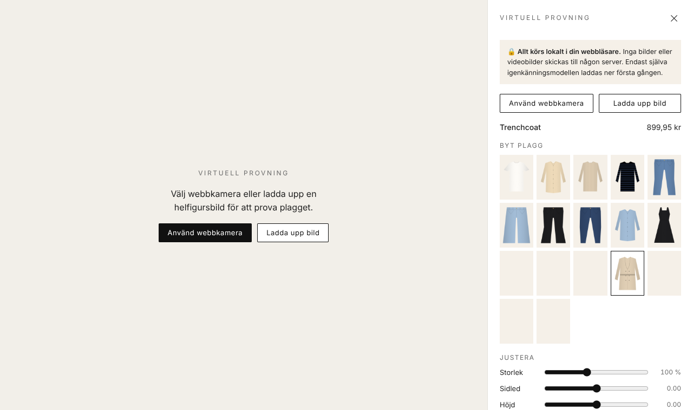

# Virtuell 3D-butik med AR-provning (prototyp)

En webbaserad, interaktiv 3D-butik i Gina Tricots butiksstil. Besökaren går runt fritt,
tittar på produkter, öppnar produktinfo och provar kläder virtuellt via webbkamera eller
en uppladdad bild.

Byggd med **Three.js** via **React Three Fiber** + **@react-three/drei**, **Vite** och
**MediaPipe Pose Landmarker** (`@mediapipe/tasks-vision`). Fungerar i Chrome, Safari och
Edge, på desktop och mobil.



> **Prototyp.** Alla produkter, produktbilder, kampanjbilder och "modefoton" är genererade
> platshållare (`npm run placeholders`). Logotypen ingår inte – se nedan.

---

## Kom igång

Kräver Node.js 18 eller senare.

```bash
npm install
```

```bash
npm run fetch-model
```

```bash
npm run dev
```

Öppna sedan http://localhost:5173.

- `npm run fetch-model` laddar ner poseringsmodellen (ca 6 MB) till `public/models/`.
  Steget är valfritt: utan modellfilen hämtas den från Googles CDN första gången
  provningen öppnas. Bara modellen laddas ner, inga bilder skickas.
- **Webbkamera kräver https eller localhost.** Om du vill testa på mobilen i samma nätverk,
  starta med ett självsignerat certifikat och öppna den https-adress som skrivs ut:

```bash
npm run dev:https
```

Bygg för produktion. Allt hamnar i `dist/` och kan läggas på valfri statisk webbhotell-tjänst:

```bash
npm run build
```

```bash
npm run preview
```

### Snabbparametrar

| URL | Effekt |
|---|---|
| `?quality=high` | AO, bloom och golvreflexer (standard på desktop) |
| `?quality=medium` | AO utan reflexer |
| `?quality=low` | ingen efterbehandling (standard på mobil) |

Utan parameter sänks kvaliteten automatiskt om bildfrekvensen faller (`PerformanceMonitor`).

---

## Mappstruktur

```
/assets            logotyp, produktbilder, kampanjbilder, foton, valfria .glb-modeller
/data              products.json
/public/models     MediaPipe-modell (npm run fetch-model)
/scripts           generering av platshållare, nedladdning av modell
/src
  /config          storeConfig.js (mått, sökvägar, .glb), zones.js, fixtures.js (inredning)
  /data            inläsning av produkter + härledd info (färger, plaggtyp)
  /i18n            svenska texter (sv.js)
  /nav             kollision, A*-vägsökning, spelartillstånd
  /scene           3D: rum, fasad, möbler, produkter, kontroller, belysning
    /fixtures      podier, bord, hyllor, klädstänger, skyltdockor, skärmar, växter …
    /products      automatisk placering + rendering av produkter
  /tryon           MediaPipe, 2D-överlagring, utjämning, provider-adapter
  /ui              startskärm, HUD, minikarta, produktpanel, önskelista, provning
/docs/screenshots  skärmdumpar från varje byggsteg
```

`vite.config.js` serverar `/assets`, `/data` och MediaPipe-WASM direkt från projektroten och
kopierar dem till `dist/` vid build. Byggda JS/CSS-filer hamnar i `dist/_app/`.

---

## Byta logotyp

Varumärkets logotyp ligger i **`assets/ginatricot-logo.png`** (`PATHS.logo` i `src/config/storeConfig.js`; byt till en `.svg` om du har en vektorversion). Den används på startskärmen,
i gränssnittets övre hörn, på den belysta skylten ovanför entrén och på väggen bakom kassan.
Koden ritar inte logotypen själv. Saknas filen visas en neutral platshållare
(`assets/logo-placeholder.svg`).

- Skylten är en vit ljuslåda, så logotypen visas i svart på vitt. Använd en SVG med `viewBox`
  och gärna `width` och `height` så att proportionerna blir rätt.
- Vill du använda ett annat filnamn ändrar du `PATHS.logo` i `src/config/storeConfig.js`.

## Deploy (Railway) och riktiga produkter

Sajten körs på Railway (projektet **gina3d**, tjänsten **gina3d-web**, gren `main`):
https://gina3d-web-production.up.railway.app

`railway.json` bygger med `npm run build` och startar `npm start` (`server.mjs` servar `dist/`).
Bygget hämtar riktiga produkter från ginatricot.com innan `vite build`, styrt av
miljövariabler på tjänsten:

| Variabel | Exempel | Effekt |
|---|---|---|
| `GT_SITEMAP` | `https://www.ginatricot.com/market_sitemaps/se/sitemap.xml` | sajtens sitemap (tillåten enligt robots.txt) |
| `GT_IMPORT_PLAN` | `tops:6,jeans:5,dresses:7,skirts:2,outerwear:5,bags:3,shoes:2` | antal produkter per kategori |
| `GT_DEBUG` | `1` | skriver ut bildanalysen i byggloggen |
| `PORT` | `8080` | serverns port |

Importen läser produktsidornas strukturerade data (JSON-LD: namn, pris, färg, material,
bilder), laddar ner bilderna, hittar den bild som är en ren produktbild (ingen hud, jämn
bakgrund), frilägger den till `tryOnImage` och uppskattar ankarpunkter för AR-provningen.
Modellfotona används i produktpanelen, på de digitala skärmarna och i tavlorna
(`data/media.json`). Misslyckas importen behålls platshållarna – bygget fäller aldrig.
De importerade bilderna finns bara i det byggda resultatet, inte i git.

## Importera riktiga produkter från ginatricot.com (lokalt)

`scripts/import-ginatricot.mjs` hämtar riktiga produkter (namn, pris, valuta, färger, storlekar,
bilder och länk) direkt från produktsidorna och skriver `data/products.json`. Skriptet läser
sidornas strukturerade data (schema.org `Product` i JSON-LD, med Open Graph som reserv) och
laddar ner bilderna till `assets/products/ginatricot/`. Kategorin gissas från brödsmulor och URL
men kan anges per rad.

```bash
cp data/import-urls.example.txt data/import-urls.txt
```

Klistra in produktlänkar i `data/import-urls.txt` och kör sedan:

```bash
npm run import:ginatricot -- --urls data/import-urls.txt
```

Eller hämta direkt från en kategorisida (best effort):

```bash
npm run import:ginatricot -- --category-url https://www.ginatricot.com/se/jeans --limit 6
```

- **AR-provningen behöver en frilagd PNG** (`tryOnImage`). Installera
  `@imgly/background-removal-node` så friläggs packshot-bilden automatiskt (lokalt, med en
  ML-modell). Annars importeras produkten med AR-provning avstängd tills du lägger en frilagd
  `assets/products/ginatricot/<id>-tryon.png` och kör importen igen:
  ```bash
  npm i -D @imgly/background-removal-node
  ```
- Utan `tryOnImage` visas produktens första foto på de framåtvända plaggen i butiken.
- `--append` lägger till produkter i stället för att ersätta listan. `--category jeans` tvingar en kategori.
- Kör skriptet där www.ginatricot.com och sajtens bild-CDN går att nå, till exempel på din egen
  dator. Blockerar sajten automatiska anrop kan du spara sidan i webbläsaren och anpassa skriptet.
- Bilder och texter tillhör Gina Tricot. Använd dem bara med varumärkets tillstånd.

## Byta produkter

All produktdata läses från **`data/products.json`**:

```json
{
  "id": "gt-001",
  "name": "Basic t-shirt",
  "price": 149.95,
  "currency": "SEK",
  "category": "tops",
  "colors": ["Vit", "Svart"],
  "sizes": ["XS", "S", "M", "L", "XL"],
  "images": ["/assets/products/gt-001-1.webp", "/assets/products/gt-001-2.webp"],
  "tryOnImage": "/assets/products/gt-001-tryon.png",
  "productUrl": "https://www.ginatricot.com/se/..."
}
```

- **category** styr vilken zon produkten hamnar i (se `categories` i `src/config/zones.js`)
  och hur den visas:

  | category | zon | visas som | AR-provning |
  |---|---|---|---|
  | `tops`, `shirts`, `blouses`, `knitwear` | Toppar | vikt + hängande | axlar till höfter |
  | `jeans`, `denim`, `trousers` | Denim/Toppar | vikt + hängande | höfter till knän |
  | `dresses` | Klänningar | hängande + skyltdocka | axlar till knän |
  | `skirts` | Klänningar | hängande | höfter till knän |
  | `outerwear`, `jackets`, `coats` | Ytterkläder | hängande + skyltdocka | axlar till höfter |
  | `bags`, `shoes`, `accessories` | Accessoarer + podiernas lägre nivåer | 3D-modell | – |

- **colors** kan vara svenska färgnamn (`"Svart"`, `"Ljus denim"` …, se `COLOR_HEX` i
  `src/data/productMeta.js`), hexkoder (`"#1d1d1f"`) eller objekt (`{ "name": "Svart", "hex": "#111" }`).
  Den första färgen används för plaggen i 3D.
- **images[]** visas i produktpanelens karusell (3:4 rekommenderas, WebP eller JPG, ca 900 × 1200 px).
  Bilderna lazy-laddas.
- **tryOnImage** är en PNG med transparent bakgrund. Plagget ska vara fotograferat eller frilagt
  rakt framifrån. Samma bild används för de framåtvända plaggen i butiken.
- Valfria fält:
  - `tryOnType`: `"upper"`, `"lower"`, `"full"` eller `"none"`. Skriver över det som härleds från category.
  - `tryOnAnchors`: var axlar/höfter och nederkant sitter i *din* tryOnImage, normaliserat 0–1:
    ```json
    "tryOnAnchors": { "left": [0.30, 0.13], "right": [0.70, 0.13], "bottomY": 0.80 }
    ```
    För `upper` och `full` är `left`/`right` axlarna, för `lower` höftlederna. `bottomY` är
    höftlinjen (`upper`) eller knälinjen (`lower`/`full`). Med rätt ankare hamnar riktiga
    produktbilder rätt utan manuell justering.

Platshållarna skapas om med `npm run placeholders` (Python 3 + Pillow). Skriptet skriver över
`data/products.json`.

## Lägga till nya zoner

1. Lägg till zonen i **`src/config/zones.js`**:
   ```js
   {
     id: 'sport',
     name: 'Sport',
     color: '#e6ece8',                 // färg på minikartan
     rect: [0, -3.5, 7, 3.5],          // [minX, minZ, maxX, maxZ] i meter
     categories: ['sport', 'activewear'],
     viewpoint: { x: 3.5, z: 3.0, lookAt: [3.5, 0] },
     tour: 'Träningskläder för alla pass.',
   }
   ```
   Lägg till id:t i `TOUR_ORDER` om zonen ska ingå i den guidade turen. Minikartan och
   snabbhoppen ("Gå till Sport") skapas automatiskt.
2. Möblera zonen i **`src/config/fixtures.js`** med byggfunktionerna och samma `zone`-id:
   ```js
   podium('pod-s1', 'sport', 2.0, -1.0),
   table('tb-s1', 'sport', 5.0, 1.0, 0, { w: 1.6 }),
   freeRail('fr-s1', 'sport', 4.0, -2.4, 0, { length: 1.8 }),
   wallBay('wb-s1', 'sport', 12.5, 0, -Math.PI / 2),   // mot högerväggen
   ```
   Kollision, vägsökning, kartfigurer och produktplatser räknas ut automatiskt. Produkter med
   kategorierna ovan placeras sedan på möblerna.
3. Ändra eller lägg till texter i `src/i18n/sv.js` vid behov.

Butikens mått (25 × 15 m, takhöjd 3,5 m) och dörröppningen finns i `STORE` i
`src/config/storeConfig.js`.

## Byta 3D-modeller (.glb)

Butiken använder lätta, procedurella low-poly-modeller som standard. Du kan byta ut dem mot
egna `.glb`-filer:

1. Lägg filen i `assets/models/`, t.ex. `assets/models/mannequin.glb`.
2. Peka ut den i `MODELS` i `src/config/storeConfig.js`:
   ```js
   export const MODELS = {
     mannequin: '/assets/models/mannequin.glb',
     plant: '/assets/models/plant.glb',
     podium: null,
     screen: null,
   };
   ```
3. Exportera modellen **i meter, med origo vid golvet och framsidan mot +Z**. Den placeras
   och roteras som möbeln den ersätter. `scale` kan sättas per möbel i `fixtures.js`.

Om filen saknas eller inte kan läsas visas den inbyggda modellen och en varning skrivs i konsolen
(`src/scene/ModelOrFallback.jsx`). Andra möbeltyper kopplar du in på samma sätt i
`GLB_KEYS` i `src/scene/fixtures/index.jsx`.

Tips för prestanda: håll modellerna under ca 20 000 trianglar och komprimera dem, till exempel så här:

```bash
npx @gltf-transform/cli optimize in.glb out.glb --texture-compress webp
```

---

## Två våningar och rulltrappor

Butiken har **entréplan** (entré, denim, toppar, accessoarer, ytterkläder, kassa) och
**övre plan** (klänningar, fest & nyheter), 4 m golv till golv (`FLOOR_H`). Rulltrapporna
upp och ned längs högerväggen konfigureras i `ESCALATOR` i `src/config/storeConfig.js`
(position, längd, hastighet) och schaktet i `VOID`. Man åker automatiskt när man kliver på;
klick på golvet, kartan, zonhopp och den guidade turen planerar vägen över båda våningarna.
Minikartan har en våningsväljare.

Möbler på övre plan läggs i `onLevel(1, [...])` i `src/config/fixtures.js`, och zoner får
`level: 1` i `src/config/zones.js`.

## Navigering

| | Desktop | Mobil |
|---|---|---|
| Gå | W A S D / piltangenter (Shift = spring) | joystick nere till vänster |
| Titta | dra med musen, eller **L** för pointer lock (Esc släpper) | svep |
| Gå till en punkt | klicka på golvet | tryck på golvet |
| Produkt | hovra för namn och pris, klicka för panelen | tryck |

- Kollision mot väggar och möbler. Klick-för-att-gå använder A*-vägsökning runt möblerna.
- **Minikartan** visar zonerna och din position. Klicka på kartan för att gå dit, eller använd
  snabbhoppen ("Gå till Denim").
- **Guidad tur** går automatiskt genom zonerna. Rör du dig själv avbryts turen.
- I produktpanelen leder **Visa i butiken** dig till platsen där produkten visas.
- Den **virtuella provspegeln** vid provrummen öppnar AR-provningen.

## Produkter, panel och önskelista

- Hover ger en lätt highlight och en etikett med namn och pris.
- Klick öppnar en sidopanel (på mobil ett bottenark) med bildkarusell, pris, färger, storlekar,
  **Prova virtuellt** och **Köp på ginatricot.com**, som öppnar `productUrl` i en ny flik.
- Önskelistan sparas i webbläsarens `localStorage` (`gt3d.wishlist.v1`) och lämnar aldrig enheten.

## AR-provning

- Två lägen: **Använd webbkamera** (`getUserMedia`) och **Ladda upp bild**.
- MediaPipe Pose Landmarker hittar axlar, höfter och knän. Plaggets `tryOnImage` skalas,
  roteras och placeras efter dem:
  - toppar och jackor: axlar och höfter
  - byxor och kjolar: höfter och knän
  - klänningar: axlar till knän
- Rörelserna utjämnas med ett One Euro-filter (`src/tryon/smoothing.js`) så att plagget inte
  hackar. Tappas kroppen ligger plagget kvar en kort stund och tonas sedan ut.
- Reglage för storlek, sidled och höjd. Plaggbyte direkt i vyn och skärmdump som PNG.
- **Integritet:** allt körs lokalt i webbläsaren och inga bilder eller videobilder skickas till
  någon server. Gränssnittet säger det tydligt. 3D-renderingen pausas under provningen för att
  spara batteri.
- **Ärligt om tekniken:** det här är en förenklad **2D-överlagring**, ingen fysisk
  tygsimulering. Veck, fall, armar framför kroppen och exakt passform beräknas inte. Det står
  både i gränssnittet och i koden (`src/tryon/overlay.js`).

### Koppla in en extern virtual try-on-tjänst

Alla provningslägen implementerar samma gränssnitt, `TryOnProvider` i
`src/tryon/providers/index.js`:

```js
{
  id, name, realtime, sendsImagesToServer, description,
  async render({ person, product, garmentImage, adjust }) { return { image, note } }
}
```

- `localOverlay.js` är den inbyggda 2D-överlagringen.
- `external.js` är en färdig mall som POST:ar person- och plaggbild till en endpoint och
  visar resultatbilden. Aktivera den med en `.env.local`:
  ```
  VITE_TRYON_ENDPOINT=https://din-backend.example.com/tryon
  VITE_TRYON_NAME=Realistisk provning
  ```
  Eller registrera en egen provider med `registerProvider()`.
- När en provider har `sendsImagesToServer: true` byter gränssnittet integritetstext och kräver
  ett uttryckligt samtycke innan något skickas. Lägg aldrig API-nycklar i webbläsarkoden; låt
  en egen backend sköta autentiseringen mot tjänsten.

---

## Realism och prestanda

Målet är 60 fps på en vanlig laptop:

- Low-poly-geometri, delade material och **instansiering**: alla vikta plagg, alla sidohängda
  plagg, spotlights och växtblad ritas med några få draw calls.
- "Bakat" ljus: environment map från ljuspaneler som renderas **en gång**, ljuskäglor som
  texturer och mjuka kontaktskuggor som renderas om bara när layouten ändras. Inga
  realtidsskuggor.
- Efterbehandling på desktop: ambient occlusion (N8AO, halv upplösning), lätt bloom på lamporna,
  NeutralToneMapping, SMAA och golvreflexer i polerat kakel. Allt sänks automatiskt vid låg fps.
- Lazy-loading: produkt-, kampanj- och fototexturer hämtas först när du närmar dig (max fyra
  samtidigt). Panelens bilder har `loading="lazy"`. MediaPipe laddas först när provningen öppnas.

**Vad som ger mest realism härnäst:** riktiga produktfoton som frilagda PNG:er (`tryOnImage`),
riktiga kampanjbilder i `assets/campaign/` och `assets/photos/`, samt skannade eller modellerade
`.glb`-modeller för skyltdockor och möbler. Platshållarna är medvetet enkla illustrationer.

## Byggsteg och skärmdumpar

| Steg | |
|---|---|
| 1. Tomt rum med navigering |  |
| 2. Butiksinredning |  |
| 3. Produkter från JSON |  |
| 4. Produktpanel |  |
| 5. AR-provning |  |

Fler bilder finns i `docs/screenshots/`.

## Kända begränsningar

- AR-provningen är en 2D-överlagring (se ovan). Den fungerar bäst med hela överkroppen eller
  hela kroppen i bild, rakt framifrån och i bra ljus.
- Webbkameran kräver https eller localhost. iOS Safari kräver att sidan öppnas i Safari, inte i
  en app-webbvy med begränsad kameraåtkomst.
- Skyltdockor och möbler är procedurella low-poly-modeller tills riktiga `.glb`-filer läggs in.
